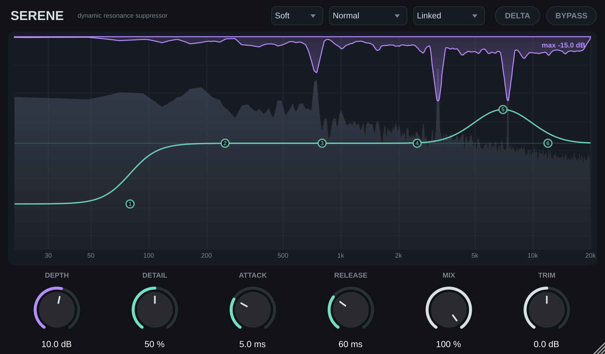

# Serene — dynamic resonance suppressor

An original soothe-style resonance tamer (VST3 / AU / Standalone, macOS + Windows), built with JUCE 8.



## How it works
STFT engine (Hann, 75 % overlap). Every frame it:
1. Measures the spectrum and builds a **peak-robust baseline** (smoothed in log-frequency, peaks clipped so a resonance can't lift its own reference).
2. Anything poking above the baseline is a resonance → reduction amount from **Depth** and **Mode**.
3. Scales by your **sensitivity curve** (6 nodes) and a level gate (ignores the noise floor).
4. Smooths across frequency (**Detail**) and time (**Attack / Release**), applies per-bin gain, resynthesises.

## Controls
| Control | What it does |
|---|---|
| **Depth** | Overall amount (0–24 dB). Max cut per bin = 1.5 × Depth |
| **Detail** | 0 % = broad, smooth reduction. 100 % = narrow, surgical notches |
| **Mode** | *Soft*: soft knee + 3 dB threshold, very transparent. *Hard*: low threshold, linear, aggressive |
| **Attack / Release** | Per-bin envelope times |
| **Mix / Trim** | Parallel blend and output gain |
| **Quality** | Low latency (256 smp ≈ 5 ms), Normal (2048), High (4096). Doubles at 88.2/96 k so resolution stays the same |
| **Channels** | Linked (one curve for L+R), Unlinked, Mid/Side |
| **Delta** | Hear only what's being removed |
| **Nodes 1–6** | Low shelf, 4 bells, high shelf. Drag = freq / sensitivity, wheel = width, double-click = reset. −12 dB = no processing there, +12 dB = 2× |

Latency is reported to the host, so Ableton compensates automatically.

## Build — the easy way (GitHub Actions)
1. Push this folder to a GitHub repo.
2. The **Build** workflow runs on macOS + Windows and uploads the plugins as artifacts (Actions tab → latest run → Artifacts).
3. Install:
   - **Mac:** `Serene.vst3` → `~/Library/Audio/Plug-Ins/VST3/`, `Serene.component` → `~/Library/Audio/Plug-Ins/Components/`.
     Unsigned build, so clear quarantine: `xattr -cr ~/Library/Audio/Plug-Ins/VST3/Serene.vst3 ~/Library/Audio/Plug-Ins/Components/Serene.component`
   - **Windows:** `Serene.vst3` → `C:\Program Files\Common Files\VST3\`
4. Ableton → Preferences → Plug-ins → Rescan.

## Build locally
Needs CMake ≥ 3.22 and Xcode (Mac) or Visual Studio 2022 (Windows). JUCE is downloaded automatically.

```bash
# macOS (universal arm64 + x86_64)
cmake -B build -G Xcode
cmake --build build --config Release

# Windows
cmake -B build -G "Visual Studio 17 2022"
cmake --build build --config Release
```
Output: `build/Serene_artefacts/Release/{VST3,AU,Standalone}`.

Tip: add `-DJUCE_DIR=/path/to/JUCE` to use a local JUCE checkout instead of downloading.

## Source map
- `Source/SpectralEngine.*` — the DSP
- `Source/Shaping.h` — sensitivity-node curve (shared by DSP and GUI)
- `Source/PluginProcessor.*` — parameters, dry/wet, M/S, latency
- `Source/SpectrumView.*` — analyser + draggable nodes
- `Source/PluginEditor.*`, `Source/SereneLookAndFeel.h` — UI
